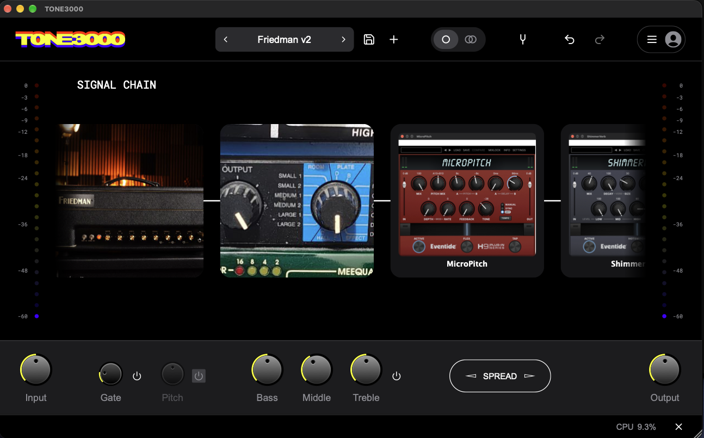

# TONE3000 + Hosted AU/VST3 Effects



> **This is a community fork of [tone-3000/tone3000-plugin](https://github.com/tone-3000/tone3000-plugin).**
> The base application — the whole TONE3000 plugin, its NAM/IR engine, UI and TONE3000
> catalog integration — is made by the **TONE3000 team**. **All credit for the app goes to
> them.** This fork only adds one feature on top (hosting AU/VST3 effects in the chain).
> Please support the original project:
> **[tone3000.com](https://www.tone3000.com)** · **[github.com/tone-3000/tone3000-plugin](https://github.com/tone-3000/tone3000-plugin)**.
>
> Upstream license: **MIT, Copyright (c) 2026 TONE3000** (see [`LICENSE`](LICENSE)). This fork
> keeps that license and the original copyright.

> ### ⚠️ Platform: macOS only
> The feature this fork adds — hosting **AU/VST3** effects — is **macOS-only**, so the releases
> here are **macOS-only** (Apple Silicon, arm64). The upstream plugin supports more platforms;
> this fork’s releases do not.

---

## What this fork adds

The upstream chain hosts **NAM (Neural Amp Modeler) captures** and **IRs**. This fork adds a
third block type — an **Effect block** — that hosts any installed macOS **Audio Unit (AU)** or
**VST3** *effect* directly in the TONE3000 chain, so you can drop a favourite EQ, compressor,
drive, reverb, etc. between/around your tones without leaving the plugin.

- **Add-effect browser** — right-click an empty `+` slot → **Add AU/VST3 Effect** → pick a
  **vendor**, then the effect. The browser lives inside the plugin (no Finder dialog), and the
  vendor column blurs behind the effect list while you choose.
- **It's a real chain block** — power on/off, remove, drag to reorder, duplicate; the effect's
  own editor opens from the tile; it is saved in presets and DAW projects.
- **State round-trips** — the effect's description + its own preset bytes are serialized with the
  project. If a hosted effect is missing on another machine the block stays visible and passes
  audio through (so projects still open).
- **Latency aware** — hosted-effect latency is reported to the host (serial path, and the longest
  parallel path).

Everything else is the upstream plugin, unchanged.

## Requirements

- **macOS** (Intel or Apple Silicon).
- **Xcode Command Line Tools** (`xcode-select --install`) — provides the SDK + compilers.
- **CMake ≥ 3.22** and **Ninja** (a build script below provisions them if missing).
- A **TONE3000 publishable key** at configure time. The plugin reads `T3K_PUBLISHABLE_KEY`
  from a repo-root `.env` (gitignored). It is the app's OAuth **client_id** (publishable, not a
  secret). Get one from tone3000.com, or copy the value the official app uses.

## Build it

**Prebuilt macOS releases** (standalone + AU + VST3) are on the
[**Releases**](https://github.com/zackyusof/tone3000-plugin-effects/releases) page — built by
GitHub Actions on a macOS runner. A **weekly scheduled job checks upstream TONE3000** and, when a
new version ships, merges it into `main` and builds a fresh release automatically. It is fully
unattended: if the merge conflicts it leaves the last release in place and opens an issue for a
human to resolve later. Building from source is also easy:

Branches: `main` = upstream trunk + the hosted-effects feature.

### Distribution identity (read before installing)

**Why this fork ships under its own name.** The first releases here reused the upstream
plugin's exact names and internal IDs (`TONE3000`, AU `aumf/T3K0/TFTF`, same VST3/LV2/CLAP
identities, same file names). That is the right choice for personal use and for pull requests
back upstream -- identical names keep configs, build targets and git tracking aligned. But it
is the wrong choice for *distributed* binaries: plugin formats tell installed plugins apart
by exactly those IDs and file names, so a fork shipping the same ones overwrites -- or shows
up as a duplicate of -- the official release in a DAW scan. Since this page distributes public
binaries, **all prebuilt releases here are namespaced** and install/scan **alongside**
official TONE3000 releases instead of colliding with them. This fork therefore has two tracks:

| track | how | identities | use for |
|---|---|---|---|
| default | plain `cmake` / `build_tone3000.py` | upstream (`TONE3000`, AU `aumf/T3K0/TFTF`, …) | local-only builds, PRs back to upstream |
| public release | `-DT3K_FORK_NAMESPACED=ON` / `build_tone3000.py --namespaced` | fork (`TONE3000 FX`, AU `aumf/T3KX/ZYUS`, own LV2/CLAP/data-dir, bundles `TONE3000-FX.*`) | anything you install next to — or give to people who have — official builds |

If you installed one of the earlier same-named fork builds (`TONE3000.component` /
`TONE3000.vst3` from a previous release here), delete those files so you don't get two
entries for the same slot -- the namespaced builds are separate files and won't remove them
for you. Source defaults stay on the upstream values, which keeps pull requests back to
`tone-3000/tone3000-plugin` compatible (its PR template pins the LV2 URI, CLAP ID, AU hints
and state format). Details: [`cmake/ForkIdentity.cmake`](cmake/ForkIdentity.cmake).
The MIT license and the original `Copyright (c) 2026 TONE3000` notice are unchanged.

**One command** (from this repo's `script/`; also shipped as an OpenCode skill):

```bash
python3 ~/.config/opencode/skills/tone3000-plugin-build/scripts/build_tone3000.py
#  -> clones the LATEST upstream, applies the hosted-effects patch, builds
#     Standalone + AU + VST3, validates (auval/pluginval), installs + packages
# add:  --standalone-only   to build just the app and put it on the Desktop
```

**Manual**:

```bash
git submodule update --init --recursive          # NeuralAmpModelerCore, AudioDSPTools
printf 'T3K_PUBLISHABLE_KEY=<your t3k_pub_... key>\n' > .env

cmake -S . -B build -G Ninja -DCMAKE_BUILD_TYPE=Release \
      -DCMAKE_POLICY_VERSION_MINIMUM=3.5          # JUCE is fetched by CPM here
sh script/patch_juce_popupmenu.sh                 # macOS popup-submenu fix (see below)
cmake --build build -j8                           # or target the three explicitly:
# cmake --build build --target TONE3000_Standalone TONE3000_AU TONE3000_VST3 -j8
```

Artefacts land in `build/plugin/TONE3000_artefacts/Release/{Standalone,AU,VST3}/`.

> Do **not** build the `DspTests` target — it fails to link (`Undefined symbols … arm64`), a
> pre-existing, unrelated upstream issue.

## How to load an AU / VST3 effect

### In the Standalone app

1. Install a copy of the app (e.g. `build/plugin/TONE3000_artefacts/Release/Standalone/TONE3000.app`).
2. In the chain, **right-click an empty `+` slot**.
3. Choose **Add AU/VST3 Effect**. A browser opens: the **left column lists vendors**; click one
   and its effects appear in the **right column** (the vendor column blurs behind).
4. Click an effect to load it — it becomes an **Effect tile** in that slot, showing a coloured
   **vendor badge** with the plugin name.
5. **Click the tile** to open the plugin's own editor window. Once you have opened it, the slot
   shows a small **picture of the plugin's interface** (captured from its window), so you can see
   at a glance what is loaded. Right-click the tile for **Open Effect Editor** / **Remove**.
6. The tile behaves like any block: power on/off (bypass), drag to move, duplicate, and it is
   stored in presets.

If the browser shows nothing, or **"No AU/VST3 effects found"**, the effect isn't in one of the
standard system folders below.

### In a DAW (AU / VST3)

1. **Install the plugin builds** into the standard macOS locations:
   - `~/Library/Audio/Plug-Ins/Components/TONE3000.component` (AU)
   - `~/Library/Audio/Plug-Ins/VST3/TONE3000.vst3` (VST3)

   The build script copies them there for you; otherwise copy the bundles from
   `…/Release/AU/` and `…/Release/VST3/`.
2. In your DAW, **rescan plugins** and insert **TONE3000** on a track (AU in Audio-Unit hosts
   such as Logic/Reaper; VST3 in any VST3 host).
3. In the TONE3000 window, **right-click an empty `+` slot → Add AU/VST3 Effect** and pick the
   effect exactly as in the Standalone.
4. Save the project — the hosted effect and its state are stored with it.

### Where hosted effects are found

The browser lists what is installed in the **two standard system folders**:

- Audio Units: `/Library/Audio/Plug-Ins/Components`
- VST3: `/Library/Audio/Plug-Ins/VST3`

(Read from disk directly — no scanning, so the browser opens instantly. User-level folders under
`~/Library/Audio/Plug-Ins/…` are not scanned.)

## Validation

| check | result |
|---|---|
| Build (Standalone + AU + VST3) | ✅ |
| `auval -v aumf T3K0 TFTF` | AU VALIDATION SUCCEEDED |
| `pluginval --strictness-level 8` (VST3 and AU) | SUCCESS |

## Limitations (honest)

- **Effects only** — the Effect block hosts AU/VST3 *effects*. Instruments, VST2, AUv3 and MIDI
  effects are out of scope for this feature.
- **In-process host** — a hosted effect runs inside TONE3000; a buggy third-party effect can crash
  the app/DAW. Start with a simple effect.
- **Unsigned build** — locally built bundles are ad-hoc signed, not notarized. On first launch
  macOS Gatekeeper may ask; right-click → Open, or clear quarantine:
  `xattr -dr com.apple.quarantine <bundle>`.
- **macOS only** — the hosted-effects feature is macOS-specific. Upstream builds on more platforms.

## Credits

- **TONE3000** — the plugin, the NAM/IR engine and the catalog integration are the work of the
  **TONE3000 team**: [tone3000.com](https://www.tone3000.com) ·
  [github.com/tone-3000/tone3000-plugin](https://github.com/tone-3000/tone3000-plugin). This fork
  would not exist without them.
- Built on **JUCE**.
- The hosted AU/VST3 effects + browser in this fork are an addition by
  [@zackyusof](https://github.com/zackyusof).

## License

**MIT** — see [`LICENSE`](LICENSE). Copyright (c) 2026 TONE3000; the hosted-effects additions
carry the same license.
